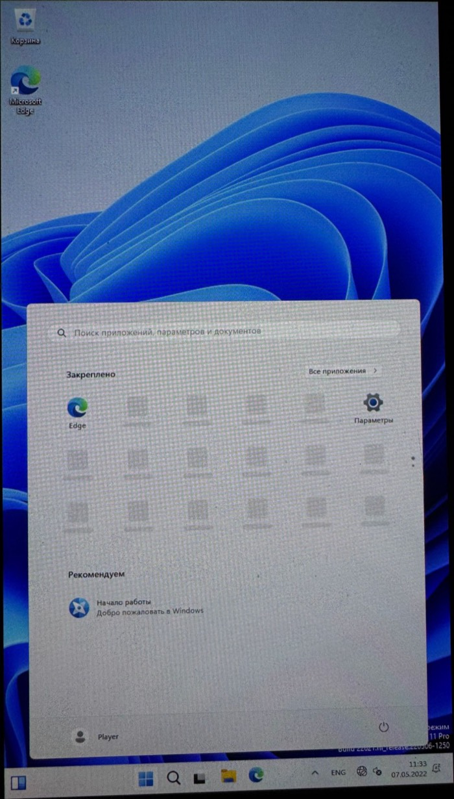

# Windows Switch

> **Built by Claude.** Almost everything in this repository was written by Claude, Anthropic's AI
> assistant, working in Claude Code. That covers the EL2 shim, the UEFI patches, the drivers, the
> image and card tooling, the debugging (from the bit-row error displays to the stage-2 SD access
> log) and this documentation. [Danil Khmyrov](https://github.com/DanilKhmyrov) owns the project and
> the console. He set the goals and ran every build on real hardware, reporting back with photos of
> the screen.

Native Windows 10 and Windows 11 on the Nintendo Switch: no emulation, no Linux underneath. Hekate starts our
own EL2 shim, the shim starts a patched [NintendoSwitchPkg](https://github.com/imbushuo/NintendoSwitchPkg)
UEFI, and UEFI boots a regular Windows Boot Manager from the SD card.

| Windows 10 ARM32 (build 15035) | Windows 10 ARM64 (22H2), Start menu opened by touch | Windows 11 ARM64 (23H2) |
|:---:|:---:|:---:|
|  |  |  |

> **The first rule of this project is not to harm the console.** Everything here was tested on one
> Mariko unit (T210B01, the OLED model HEG-001). Clock and voltage changes stay within the limits used by
> Horizon. Use at your own risk.

> **Experimental, for developers.** This is a research project, not a polished installer.
> The ARM64 path below is scripted end to end, but so far it has only been run on the author's
> card, which was set up step by step; the clean-card path was tested on a disk image, not on a
> second console. Touch works on all three, Wi-Fi on Windows 11; there is no USB yet. Windows 11 was installed next
> to Windows 10 on the test card with `desktop/add_windows_partition.py` (see below).
> The ARM32 path depends on a rare 15035 build and an IoT Core BCD and is documented for reference.

## Status

| | Windows 10 ARM32 | Windows 10 ARM64 | Windows 11 ARM64 |
|---|---|---|---|
| Build | 15035 (Enterprise Insider Preview) | 19041/19045 (22H2 Pro) | 22631 (23H2 Pro) |
| Boot to desktop | yes, autologon as user `Player` | yes, autologon as user `Player` | yes, autologon as user `Player` |
| CPU cores | 1 | 4 at ~1786 MHz (via PSCI trapping in the shim) | 4, same shim |
| SD card | inbox `sdbus` | inbox `sdbus` through the shim's stage-2 trap | same, **UHS-I SDR104** (1.8 V, 204 MHz): ~69 MB/s sequential, ~1700 random 4 KB reads/s ([details](#sd-card-speed-windows-11)) |
| Touch screen | yes, multi-touch (`drivers/swhid`) | yes, same driver built for ARM64 | yes, same ARM64 binary |
| Battery, charger, fan, overheat shutdown | yes (`drivers/swbatt`) | yes, same driver built for ARM64 | yes, same ARM64 binary |
| CPU / RAM clocks | 1785 MHz at 1120 mV / ~1600 MHz | same UEFI code | same UEFI code |
| Display | GOP framebuffer (Basic Display), portrait | same | same |
| Wi-Fi (BCM4356 on PCIe) | no | no (WiFiCx needs Windows 11) | **yes**: 2.4 and 5 GHz (802.11ac), WPA2, Internet ([details](#wi-fi-windows-11)) |
| Bluetooth (BCM4356A3 on UART-D) | no | no | **yes**: a Bluetooth mouse works ([details](#bluetooth-windows-11)) |
| Speaker / headphones (ALC5639 on I2S1) | no | no | **yes**: speaker and headphones, switched when plugged in ([details](#audio-windows-11)) |
| Volume buttons | no | no | **yes**: Windows volume, with its flyout |
| Power button | no | no | short press: screen off/on; held 4 s: Ctrl+Alt+Del screen (power menu); held + volume: brightness |
| Shut down from Windows | no | the console powers off (shim, PMIC) | the console powers off (shim, PMIC) |
| Clock | no | no | the PMIC RTC: correct time at boot without network, once Windows has synced once |
| USB (USB-C port) | no | no | **yes**: a wireless mouse receiver through an OTG adapter, port powered by the console ([details](#usb-windows-11)) |
| GPU (GM20B) | no | no | **experimental**: an external render driver starts and powers the GPU, nothing is drawn with it yet ([details](#gpu-experimental-windows-11)) |
| Remote access | no | no | optional OpenSSH server, key login over Wi-Fi ([details](#ssh-windows-11)) |

Windows 11 24H2 and later will not run: they need ARMv8.1 atomics, which the Cortex-A57 lacks.

## How it works

```
Hekate (l4t=1) ──> BL31 (ATF, EL3) ──> shim, bl33 (EL2) ──> UEFI (EL1) ──> Windows Boot Manager ──> Windows (EL1)
```

### Shim (`shim/`)

Hekate's L4T loader starts `bl33.bin` at 0xAA000000 in EL2. The shim:

- waits a few seconds (`--delay-ms`): on Mariko the BPMP firmware is still training DRAM after
  Hekate, and early UEFI hung while that was in progress (3 s for ARM32, 10 s for ARM64, whose
  early UEFI memory sits above 4 GB);
- copies UEFI to 0x80110000 and drops to EL1, either AArch32 (`chain32`) or AArch64 (`chain`);
- **ARM64 only** stays resident as a minimal hypervisor in reserved memory:
  - **SMC/PSCI trapping** (`HCR_EL2.TSC`). ATF starts secondary cores at EL2, so `PSCI CPU_ON`
    is rewritten to enter `secondary_entry`, which drops the new core to EL1 and jumps to the
    Windows entry point;
  - the trap is switched on only when UEFI hands over to the OS. UEFI signals this by reading
    `ACTLR_EL1` (trapped through `HCR_EL2.TACR`), because ATF disables HVC;
  - **stage-2 translation** maps everything 1:1 except the SDMMC page 0x700B0000. Windows
    accesses to it are emulated with the same width and logged, and bit 28 ("64-bit system bus")
    of the SDMMC1 capabilities register is cleared, so `sdbus` uses 32-bit ADMA2 like ARM32 does.
    Bits 15:8 (base clock) are replaced with the real 48 MHz. The Windows 11 loader also adds
    UHS-I SDR104: the shim does the Tegra side of the 1.8 V switch, the clock and the tuning when
    `sdbus` writes host control 2, see [SD card speed](#sd-card-speed-windows-11);
  - **PSCI SYSTEM_OFF** (Windows shutdown): ATF does not remove power on the Switch, so the shim
    does what hekate's "Power off" does: over I2C5 it clears the soft-reset and alarm wake-ups in
    the MAX77620 `ONOFFCNFG2` and writes `ONOFFCNFG1 = SFT_RST`;
  - **SError handling** (`HCR_EL2.AMO`): an asynchronous bus error is swallowed. On the first one,
    ESR, ELR and the latest SD register accesses are drawn as bit rows at the top of the screen.
    This is how the ARM64 hangs below were diagnosed without a UART.

### UEFI (`uefi/`, `patches/`)

`uefi/build.sh` builds NintendoSwitchPkg on `edk2-stable202102` in Docker and applies
`patches/*.patch` in alphabetical order. Patches named `*-a64only.patch` go into the 64-bit build
only, and `*-cleanonly.patch` only into `CLEAN=1` builds.

| Patch | What it does |
|---|---|
| `hekate`, `sd-power`, `zsdhost` | boot from Hekate's L4T entry; power up SDMMC1 the way Hekate does; SD host fixes; describe SDMMC1 (`PNP0D40`) in the DSDT |
| `zarm32` | 32-bit (ARM) build of the package |
| `zzfan` | fan on at boot |
| `zzztouch`, `zzzztouchacpi` | touch panel power-up, `SWTS0001` ACPI device for the HID driver |
| `zzzzzzzclean`, `*clean-cleanonly` | optional black (clean) boot screen |
| `*cpu1428` | CPU 1785.6 MHz at 1120 mV (MAX77812 over I2C5, PLLX reprogrammed while running from clk_m) |
| `*bpmp` | RAM ~1600 MHz: asks the BPMP firmware over IPC (`MRQ_CLK`, clock `emc`) |
| `*ram408` | older Hekate-style RAM boost (unused, must not be combined with BPMP) |
| `*diag` | small progress marks at the bottom of the screen |
| `*el1-a64only`, `*shim-a64only`, `*ebs-a64only` | AArch64 at EL1; reserve the shim's 1 MB; ExitBootServices signal to the shim |
| `*rtnull-a64only` | Null DebugLib/SerialPortLib for runtime drivers (they crashed after SetVirtualAddressMap) |
| `*nouart-a64only` | hide UART B (`NVDA0100`): it is unclocked and the inbox ARM64 driver hit an SError |
| `*cca-a64only` | `_CCA = 0` on SDMMC1: Tegra SDMMC DMA does not snoop CPU caches |
| `*bootopt-a64only` | register "Windows Boot Manager" with a full partition device path; boots the partition holding `\EFI\Boot\bootaa64.efi` |
| `*win11-win11only` | `WIN11=1` builds (`bl33-64-win11.bin`) boot the partition holding `\EFI\Microsoft\Boot\win11.tag` instead, so both systems can share one card |
| `*wifi-win11only` | Wi-Fi preparation and the ACPI device `WFI0` (`SWOA0D01`), see [Wi-Fi](#wi-fi-windows-11) |
| `*audio-win11only` | audio preparation and the ACPI device `AUD0` (`SWOA0C01`), see [Audio](#audio-windows-11) |
| `*bluetooth-win11only` | Bluetooth preparation and the ACPI device `BTH0` (`SWOA0B01`), see [Bluetooth](#bluetooth-windows-11) |
| `*usb-win11only` | XUSB host preparation and the ACPI devices `XHC0` (`PNP0D10`) and `XFW0` (`SWOA0D02`), see [USB](#usb-windows-11) |

### Windows images (`desktop/`)

Windows files are not part of this repository. The scripts build NTFS partition images from your own
Microsoft images inside a Linux container (`ntfs-3g`, `hivex`, `wimlib`):

- `build_w32.sh`: Windows 10 ARM32 from a 15035 archive. Adds the answer file, the `swagent`
  diagnostics service, the drivers, and a setup wrapper that keeps the setup logs.
- `build_w64.sh`: Windows 10 ARM64 from an ESD, with every fix the test console needed (see
  [Getting started](#getting-started-windows-10-arm64)). Also produces the boot partition contents
  and a BCD generated from the image's own `BCD-Template` for your card.
- `setup_card.py`: partitions a card for ARM64 and installs a build onto it (macOS).
- `add_windows_partition.py`: adds a second ARM64 Windows (Windows 11) to a card that already has
  one: writes the image into free space and an MBR slot, puts its boot manager with the
  `win11.tag` marker on the Hekate partition and creates the `wp11` menu entry.
- `make_bcd.sh` (ARM32, from an IoT Core BCD), `make_bcd64.sh`, `bcdlib.py`: BCD stores pointing at
  MBR partitions by disk signature and offset.
- `skip_bcd_step.sh`: removes `Sysprep_Specialize_Bcd`, which needs persistent UEFI variables.
- `put_bl33.sh`, `put_bcd.sh`, `finalize_menu.py`, `make_icon.py`: update loaders, the BCD and the
  Hekate menu on the test console's card.
- `pull_win.py`, `push_win.py`, `img_sums.py`, `sync_from_card.py`, `replace_extent.py`,
  `hive_recover.py`, `setup_mode.sh`, `finish_setup.sh`: offline maintenance. They copy a partition,
  write back only the changed MiB, patch a registry hive in place, and recover hives left dirty
  by a power-off.
- `w32.cmd`, `w64.cmd`: run by `swagent` on every boot from the FAT boot partition
  (`findagent64.cmd` finds it even when Windows gives it no drive letter). The Mac can edit them
  without root, and they write logs that can be read back from the Mac.

### Drivers (`drivers/`)

WDM drivers built in Docker with clang/lld against the Enterprise WDK 14393 headers (not included),
test-signed:

- `swhid`: HID touch screen digitizer for the FTS4 panel on I2C3 (up to 5 fingers), plus:
  - the volume buttons (PX6/PX7) as a Consumer Control collection (Volume Increment/Decrement);
  - the power button (MAX77620 ONOFFSTAT EN0 on I2C5): a short press switches the screen off
    and on (on the OLED model the panel's own brightness, DCS SET_BRIGHTNESS over DSI as in
    hekate; on LCD models the backlight PWM, not tested) and ignores touch while it is off;
    held 4 s it sends Ctrl+Alt+Del from a
    minimal keyboard collection, so Windows shows its security screen with the power menu and a
    Cancel button; held with volume up/down it changes the brightness;
  - the clock: the MAX77620 RTC keeps time while the console is off, but Horizon owns it, so it is
    never written. Once Windows has a real time (NTP), the offset to the RTC is kept in
    `Services\swhid\Parameters\RtcOffset`, and at every start the system time is set from it.
    Without this, Windows starts in 2022 (the UEFI clock) until it reaches the network;
  - I2C5 (PMIC) is shared with `swbatt` through a named synchronization event;
  - the touch supply: PMIC LDO6 must be 2.9 V ("vdd-tp-2v9" in Switchroot). It was sometimes
    found at 1.0 V, where the panel answers on I2C but never senses anything. The driver sets
    2.9 V before it starts the panel, and power-cycles the panel (LDO6 and reset PJ7) when it does
    not report ready;
- `swbatt`: battery class miniport (MAX17050 fuel gauge, BQ24193 charger, TMP451 temperature),
  fan curve and overheat shutdown; on Windows 11 also the headphone jack (PV6): it moves the sound
  between speaker and headphones with the codec's mute bits over I2C1, which it already owns;
  the USB port power (see [USB](#usb-windows-11)); and the power bridge of the experimental GPU
  driver (see [GPU](#gpu-experimental-windows-11)).

`ARCH=arm64 drivers/build.sh` builds the same sources for ARM64. The 14393 headers already
support ARM64. Instead of WDK libraries, the import libraries are generated from the export tables
of the real ARM64 `ntoskrnl.exe`, `hal.dll`, `battc.sys` and `hidclass.sys` taken from the Windows
image. On ARM64, `w64.cmd` installs both drivers from `agent\arm64\` on the boot partition, binds
`ACPI\SWTS0001` and creates `ROOT\SWBATT`, then reboots once.

- `switchwifi` (Windows 11 only): see [Wi-Fi](#wi-fi-windows-11).
- `switchbt` (Windows 11 only): see [Bluetooth](#bluetooth-windows-11).
- `switchaudio` (Windows 11 only): see [Audio](#audio-windows-11).

## Getting started: Windows 10 ARM64

You need a Switch with Hekate (tested on Mariko only), a microSD card of 32 GB or more that may be
**erased completely**, a Mac (the card scripts use `diskutil`), Docker, and about 30 GB of free disk
space.

1. **Back up your SD card.** Everything on it is erased, including emuMMC and Linux/Android.
2. **Partition the card.** In Hekate open *Tools > USB Tools > SD Card*, connect the console, find
   the card with `diskutil list` and its exact size with `diskutil info diskN`, then:
   ```bash
   sudo python3 -I desktop/setup_card.py partition diskN <size in bytes>
   ```
   Note the four numbers it prints at the end: disk signature, Windows partition start, boot
   partition start, Windows partition size.
3. **Put Hekate back** onto the `SWITCH` partition (the files from a Hekate release), then unzip
   `windows-switch-arm64-loader-*.zip` from the [Releases](../../releases) page onto it (v0.1.x: `windows-10-switch-...`). Copy `bl31.bin`
   from a Switchroot L4T Ubuntu release (`switchroot/ubuntu/bl31.bin`) into `wp64/`.
4. **Get Windows 10 22H2 ARM64** as an ESD or WIM from Microsoft (for example through UUP dump), and
   find the Pro edition index with `wimlib-imagex info file.esd`.
5. **Build the image** with the numbers from step 2:
   ```bash
   docker build -t switch-wp-drivers drivers
   docker run --rm --device /dev/fuse --cap-add SYS_ADMIN -v "$PWD:/project" \
       -v /path/to/esd/folder:/esd -v /path/to/output:/out switch-wp-drivers \
       /project/desktop/build_w64.sh /esd/file.esd <index> /out <signature> <win start> <boot start> <size>
   ```
6. **Write it to the card** (checks that the build matches this card):
   ```bash
   sudo python3 -I desktop/setup_card.py install diskN <size in bytes> /path/to/output
   ```
   Then unzip `windows-switch-arm64-drivers-*.zip` from the Releases page onto the `WINBOOT`
   partition (it creates `agent\arm64\` with the touch and battery drivers). If you built the
   drivers yourself into `drivers/out/arm64/`, `build_w64.sh` has already put them there.
7. **Boot** *Windows 10 ARM64* from Hekate's Launch menu. The screen stays black for about 10 s,
   then UEFI marks, the Windows logo and setup. The first boot takes 30-60 minutes and reboots
   by itself; pick the entry again if Hekate comes back. It ends on the desktop with autologon as
   `Player`. On the first desktop boot the agent installs the touch and battery drivers and
   reboots once more; after that, touch and the battery icon work. Logs are in `agent\` on the
   `WINBOOT` partition.

## Windows 11 ARM64

Same pipeline as Windows 10 ARM64, with a Windows 11 23H2 ARM64 ESD:

1. Build the image with `build_w64.sh` for the target partition, and the loader with
   `WIN11=1 ARCH=AARCH64 ./uefi/build_bl33.sh` (produces the `-win11` firmware).
2. `sudo python3 -I desktop/add_windows_partition.py partition ...` writes the image,
   `... hekate ...` adds the boot files and the *Windows 11 ARM64* menu entry.
3. Setup stops once with "Windows could not update the computer's boot configuration". Images
   built now contain `setupwatch.cmd`: it sees that error in `setupact.log` and sets
   `HKLM\SYSTEM\Setup\Status\ChildCompletion\setup.exe = 3`, so after the error dialog setup
   should continue by itself (not yet tested on a fresh install). Manual fix for older images:
   power off, recover the `SYSTEM` hive (`hive_recover.py`), set that value and write the hive
   back in place (`replace_extent.py`).
4. On the first desktop boot the agent installs the same ARM64 touch and battery drivers and
   reboots once. With the Wi-Fi package in `agent\wifi\` it also installs Wi-Fi (next section).

## Wi-Fi (Windows 11)

The Switch's Wi-Fi is a Broadcom BCM4356 on Tegra PCIe root port 1. The Windows driver is
**SwitchWifi from the [winx](https://github.com/steck0714/winx) project**
([ruje0504-2/Windows-for-Switch-Drivers](https://github.com/ruje0504-2/Windows-for-Switch-Drivers),
`drivers/SwitchWifi`, GPL-2.0), a KMDF/NetAdapterCx/WiFiCx driver. WiFiCx exists only on
Windows 11, so Windows 10 gets no Wi-Fi. Tested on the console: scan, WPA2-Personal, DHCP and
Internet on 2.4 GHz and on 5 GHz (802.11ac, channel 36). Throughput and sleep are not measured yet.
After installing or updating the driver the agent reboots once: Windows restarts the device in
place, and a stopped BCM4356 can still scan but not join until UEFI prepares it again at boot.

What this repository adds:

- **UEFI** (`*wifi-win11only.patch`, `WifiProbe` in `SdMmc.c`): checks the PMIC rails (LDO1
  "vdd-pex" at 1.0-1.05 V and SD3 at 1.8 V, as in Switchroot's `tegra210b01-nx-pmic.dtsi`; it
  turns LDO1 on only when it is off, and never changes SD3), enables the 32 kHz clock, brings up the
  T210B01 UPHY, PLLE and root port 1, trains the link, assigns the BARs and reads the chip ID.
  DMA stays off. On success the AFI bypasses the SMMU and SPI 98 is routed to the GIC; on any
  failure the radio and the port go back into reset and the result is drawn as rows of squares.
  The sequence follows Switchroot Linux as ported by winx. For Wi-Fi, Switchroot's Iowa (`modin`)
  and Lite (`vali`) device trees use the same rails, pins and port.
- **ACPI** `WFI0` (`SWOA0D01`) with the resources and the `WIRS` isolation method the driver
  expects; `_STA` hides it unless UEFI left the PCIe controller running.
- **Build**: `drivers/build_wifi.sh` builds `switchwifi.sys` with clang-cl and lld-link against
  the WDK 10.0.26100 NuGet packages (`Microsoft.Windows.WDK.ARM64`, headers of
  `Microsoft.Windows.SDK.CPP`) and test-signs it.
- **Install**: `w64.cmd` copies the board firmware to `System32\drivers\SwitchWOA`, makes the
  catalog with the WDK's Inf2Cat on the console, signs it with PowerShell and runs `pnputil`.
  The signing certificates are made on the console itself (`wifi_sign.ps1`: a test root and a
  code-signing certificate issued by it, non-exportable keys), so no signing key is shipped.

Put on the boot partition in `agent\wifi\`: `switchwifi.sys`, `switchwifi.inf`,
`wifi_sign.ps1`, the WDK's `bin\10.0.26100.0\x86\`
folder as `inf2cat\`, and the firmware `brcmfmac4356A3-pcie.bin` / `brcmfmac4356A3-pcie.txt`.
The firmware is not in this repository (Cypress license): the `.bin` is in
[CTCaer/switch-l4t-kernel-4.9](https://github.com/CTCaer/switch-l4t-kernel-4.9)
(`firmware/brcm/brcmfmac4356A3-pcie.bin.ihex`, convert it from Intel HEX), the `.txt` in
Switchroot's `nx-firmware`. Set a random locally administered `macaddr=` in the `.txt`: the
shipped one is the same for every console.
`build_wifi.sh` test-signs `switchwifi.sys` with `drivers/test-cert/wifi.key`, which is not
published: to rebuild, make your own test root and CA:FALSE code-signing certificate (valid from
before 2022) under the same names. Windows in test-signing mode loads it either way.


## Bluetooth (Windows 11)

The Bluetooth core of the same BCM4356 sits on UART-D (H4). The Windows driver is
**SwitchBluetooth from the winx project** (`drivers/SwitchBluetooth`, GPL-2.0): a KMDF
transport under Windows' inbox BthMini stack that loads the Broadcom patch, gives the controller
a stable address and switches to 3 Mbaud with flow control. Tested on the console: a Bluetooth
mouse pairs and works.

- **UEFI** (`*bluetooth-win11only.patch`, `BtPrepare` in `SdMmc.c`): UART-D pins and PH3/PH4/PH5
  as in Switchroot's Iowa (`modin`) and Lite (`vali`) trees (identical for Bluetooth), UART-D from
  PLLP at 115200, the PMIC 32 kHz clock, chip power (PH4), a check that the ROM answers
  HCI_Reset and Read_Local_Version, and SPI 90 routed to the GIC.
- **ACPI** `BTH0` (`SWOA0B01`): UART-D registers and GSI 122; present only while UART-D runs.
- **Build**: `drivers/build_bt.sh` (KMDF 1.15, same toolchain as Wi-Fi).
- **Install**: `w64.cmd` copies the patch to `System32\drivers\SwitchWOA` and installs the
  package like Wi-Fi. Put `switchbt.sys`, `switchbt.inf` and `BCM4356A3.hcd` in `agent\bt\`;
  the patch is `firmware/brcm/BCM4356A3.hcd.ihex` in
  [CTCaer/switch-l4t-kernel-4.9](https://github.com/CTCaer/switch-l4t-kernel-4.9) (Intel HEX,
  39008 bytes once converted), not redistributed here.

## Audio (Windows 11)

The speaker path goes ADMA -> ADMAIF1 -> XBAR -> I2S1 -> the Realtek ALC5639 codec -> its class D
amplifier. The Windows driver is **SwitchAudio from the winx project** (`drivers/SwitchAudio`,
GPL-2.0), a PortCls WaveRT driver that only feeds ADMA; everything else is set up by UEFI.
Tested on the console: sound from the speakers.

- **UEFI** (`*audio-win11only.patch`, `AudioPrepare` in `SdMmc.c`), ported from the winx Lite
  audio bring-up. For audio, Switchroot's Iowa (`modin`) and Lite (`vali`) trees are the same:
  - the audio pads are supplied by SD3 at 1.8 V and set to 1.8 V, as Switchroot does;
  - the APE partition and clocks are turned on;
  - the codec gets its power (PZ4) and its Switchroot init list;
  - I2S1 runs as master at 48 kHz from clk_m;
  - the speaker volume is -18 dB.

  Headphones are used instead when they are plugged in at boot (PV6, the jack switch).
- **ACPI** `AUD0` (`SWOA0C01`) with the AHUB and ADMA registers. It has no codec I2C resource,
  because there is no Windows I2C1 driver. Instead, our `swbatt` follows the jack while Windows
  runs: it shares I2C1 with the codec (see Drivers).
- **Build**: `drivers/build_audio.sh`; **install**: `w64.cmd` from `agent\audio\`.

## USB (Windows 11)

The USB-C port is the Tegra XUSB host. The Windows driver is the inbox `USBXHCI`; this repository
only brings the controller up and powers the port. Tested on the console (Switch OLED): the
controller shows up without errors, and a wireless mouse receiver in a USB-C OTG adapter works,
with the port powered by the console. Keyboards, flash drives and hubs are not tested yet.

- **Firmware**: the controller runs NVIDIA's Falcon firmware for T210B01, which is not in
  linux-firmware and is not included here. Take `lib/firmware/tegra210b01_xusb_firmware`
  (122368 bytes) from the `initramfs` of a Switchroot Ubuntu image (the file has a 64-byte
  U-Boot header, then gzip, then cpio) and copy it to the root of the FAT partition. Without it the
  UEFI does nothing and Windows sees no USB controller.
- **UEFI** (`*usb-win11only.patch`, `XusbPrepare` in `SdMmc.c`), ported from the winx Lite
  bring-up (`t214/usb-host.h`), which follows Switchroot's `xhci-tegra.c` and
  `xusb-tegra210.c`. On every Mariko board the port is usb2-0 (OTG) with SuperSpeed on PCIe PHY
  lane 5; the Wi-Fi keeps lane 0. It runs at ReadyToBoot, when the FAT partition can be read:
  - PLLU and the UTMI PLL. The UTMI PLL is first taken out of IDDQ: hekate leaves it there after
    its USB mass storage mode;
  - the XUSBA/XUSBC partitions, clocks and resets;
  - the UTMI pad with the fuse calibration, and lane 5;
  - the firmware is loaded into reserved memory below 4 GB and the Falcon is started;
  - the host is left halted for Windows, and its interrupts go to the CPU.

  On any failure the host goes back into reset and the stage and register values are drawn as
  rows of squares. `XHC0` is visible only while the host is out of reset, so Windows never meets a
  half-started controller.
- **ACPI** `XHC0` (`PNP0D10`, `_CCA = 0`, host registers and SPI 39) and `XFW0` (`SWOA0D02`, the
  Falcon mailbox for winx's `tegraxusb`; it is not installed yet and shows as an unknown device).
- **Port power** (`swbatt`), as Switchroot's `bm92txx.c` and `bq2419x-charger.c`: when the BM92T
  USB-C controller reports a device that wants power (an OTG adapter), the driver
  - enables the 5.3 V source (PX3) and VCONN (PK5);
  - puts the BQ24193 charger into VBUS mode at 1.3 A;
  - keeps the BM92T's over-current protection on.

  Everything is switched back when the device is removed, on a charger boost fault and when the
  driver stops. It only runs when the BM92T and the charger report the expected chip IDs and the
  XUSB host is running. A USB-C hub with its own charger needs no port power.

## SD card speed (Windows 11)

Windows read the SD card at about 3 MB/s (35 random 4 KB reads per second). The SDMMC1
capabilities register reports a 208 MHz base clock, but UEFI clocks the controller at 48 MHz
(PLLP / 8.5). `sdbus` divided the 208 MHz by 6 to stay under 50 MHz, so the card ran at 8 MHz.
The shim already emulates the reads of that register and now reports the real 48 MHz. `sdbus`
then uses no divider: SD high speed at 48 MHz, 3.3 V, 4-bit.

Measured on the console:

| | before | after |
|---|---|---|
| sequential read | 3.3 MB/s | 20.7 MB/s |
| random 4 KB reads | 35/s | 1302/s |
| boot until the agent starts | up to 10 min | about 2 min |

### UHS-I SDR104 (v0.7.1)

The Windows 11 loader is built with `shim/build.py ... --uhs sdr104`. The shim then reports SDR50
and SDR104 in capabilities 1 and does the Tegra side of UHS, which `sdbus` does not know about,
when `sdbus` writes host control 2 (it still does the SD protocol: CMD11, CMD6, CMD19 tuning):

- **1.8 V** (`VDD_180` set): MAX77620 LDO2 (the SD I/O rail) to 1.8 V over I2C5, PMC
  `PWR_DET` for the SDMMC1 pads, Schmitt triggers on the six SD pins, pad autocalibration with the
  T210B01 offsets, SDHCI power control 1.8 V. Cleared again: back to 3.3 V.
- **SDR104**: SDMMC1 clock 204 MHz from PLLP (hekate uses 199.68 MHz from PLLC4, which UEFI may
  not run), tap 11; the Tegra hardware tuning is set up (128 tries) when `sdbus` starts tuning.
  SDR50, if chosen, runs at 90.7 MHz as SDR104 (the T210 errata), 256 tries.
- DDR50 is not offered: on the console it ended in `UNMOUNTABLE_BOOT_VOLUME`, and Linux does
  not enable it on Tegra210 either.

All of it sits after the old shim code, which keeps its addresses: when code inside the trap
handler moves, the early UEFI hangs (squares 2 and 6). Every boot logs one retried read of LBA 0
(`disk` event 153) at the moment of the switch; the retry succeeds.

Measured on the console (one microSD card, 1 GB written and read back with matching SHA-256,
then again after a reboot):

| | high speed 48 MHz | SDR50 90.7 MHz | SDR104 204 MHz |
|---|---|---|---|
| sequential read | 20.7 MB/s | 36.5 MB/s | 68.9 MB/s |
| random 4 KB reads | 1302/s | 1611/s | 1689/s |

Random reads hardly change: there the card itself is the limit. Writes measured 10.4 MB/s with
write-through. `docs/uhs-plan.md` has the register map and the test history. To go back, use
the loader built without `--uhs` (high speed at 48 MHz).

The agent also measures this once when `agent\perf.flag` exists (boot time, sequential and random
reads of the recovery image) and writes `agent\perf.txt`.

## Agent options (Windows 11)

Opt-in flag files in `agent\` on the CRASHDUMP partition:

- `defender-off.flag`: turns Microsoft Defender off (policies, preferences, its scheduled tasks).
  On this SD card its real-time scans and 220 MB signature downloads cost a lot. Windows only
  honours it after **Tamper Protection** is switched off by hand in Windows Security. Without the
  flag Defender stays as it is.
- `remove-win10.flag`: one-time removal of a Windows 10 partition that directly follows C:, then
  C: grows over the free space (`remove_win10.ps1`). Windows refuses to delete a partition that
  holds its page file; then remove the partition table entry on another machine and keep the flag:
  the agent only grows C: when the partition is gone.
- `perf.flag`: one speed measurement, see above.

Settings that only need to be applied once (power plan, OneDrive, Windows Update, Defender) are
skipped while `w64.cmd` equals the copy saved after its last full run, so the agent no longer
spends minutes on every boot. Crash minidumps of user-mode programs go to `agent\dumps`;
`desktop/dumpinfo.py` prints the exception and the module from such a dump on any machine.

## SSH (Windows 11)

Optional. Put Microsoft's Win32-OpenSSH ARM64 build
([PowerShell/Win32-OpenSSH](https://github.com/PowerShell/Win32-OpenSSH/releases), tested:
v9.5.0.0p1, `OpenSSH-ARM64.zip`) and your public key as `authorized_keys` into `agent\ssh\`. The
agent installs it (`ssh_setup.ps1`) with key login only, no passwords, and port 22 open to the
local subnet only, and writes the address to `agent\ip.txt`.

Notes from getting it to work:

- OpenSSH 10.4 dropped every connection right after accepting it on this console.
- The per-connection child of `sshd` runs unprivileged and must be able to read `sshd.exe`.
  Files moved from a temporary folder keep that folder's ACL (Administrators and SYSTEM only).
  `icacls "C:\Program Files\OpenSSH" /reset /T` restores Program Files' ACL.
- On a Russian Windows the group is "Администраторы", so the default
  `Match Group administrators` block is replaced by listing both key files.
- To run a PowerShell script remotely, pipe it in: `ssh switch "powershell -Command -" < x.ps1`.

## GPU (experimental, Windows 11)

The Tegra X1's GPU (GM20B, `GM20B_B` on Mariko) has no Windows driver from NVIDIA. The
[mesa-switch-woa](https://github.com/ruje0504-2/mesa-switch-woa) project (ruje0504-2) writes one:
a WDDM/MCDM kernel driver (`tegra-x1-wddm/`) and Mesa NVK for Windows. Their desktop is not
stable yet. Here it is only integrated, as a separate test loader (`GPUTEST=1` build, not in the
releases):

- **UEFI** (`*gpu-gputestonly.patch`): ACPI `GPU0` (`SWOA0F01`) with the render resources of their
  `t214_resources.h` and the LIC window, which the driver requires.
- **Power bridge** in `swbatt`: the driver reaches the PMIC through `\Device\SwitchBacklight`
  (winx's SwitchFan on the Lite). Ours allows reads of the MAX77812 and writes only to its M1 (GPU)
  rail: the voltage within 0.6–1.05 V and the M1 enable bit. Writes to M3 (DRAM) or M4 (CPU) are
  refused. Kernel callers only.
- **Build**: `drivers/build_gpu.sh` (their sources, our toolchain). The NVIDIA firmware comes from
  NVIDIA's `nvidia-l4t-firmware` 32.7.6 package (`lib/firmware/tegra21x`) and is not included.

Confirmed on the console (Switch OLED): the driver starts with Code 0 and powers the GPU up itself
(M1 at 0.8 V through the bridge).

**First drawing on the GPU (2026-11-13).** Their diagnostic KMDF driver `tegragpuprobe`
(`drivers/build_gpu_probe.sh`, installed by the agent with `agent\gpuprobe\run.flag`, see
`desktop/gpuprobe.ps1`) runs fixed workloads at 729.6 MHz and reads the pixels back:

| test | result |
|---|---|
| blue clear (`--gpu-clear-729`) | pass: 256 pixels and all guard words match |
| red triangle from a NAK-compiled SM53 shader (`--gpu-draw-729`) | drawn and checked: image hash `F20AF985`, shader hash `FB041DD2`, the same as on their Switch Lite; no GR, MMU or FIFO faults |

The second run ended with an error only because, while powering down, the driver tried to restore
an M1 voltage code of `0x10` (0.33 V) it had read; the bridge refused it as outside 0.6–1.05 V. The
rail itself was switched off.

**First Vulkan draw (2026-11-13).** Their Mesa NVK Vulkan driver, built for Windows ARM64 with
`drivers/nvk/build.sh` (Docker: Mesa host tools, NVK ICD, Khronos loader, their `vk-triangle`),
runs on the OLED's GM20B:

- the render driver built with `NATIVE=200` (native submission, without the display panel) starts
  natively once with the author's one-time permit (`desktop/gpuvk.ps1`, `agent\gpuvk\run.flag`):
  every start status 0;
- `nvk-windows-check`: one physical device, the native-ready adapter's LUID matches;
- `vk-triangle`: `{"vulkan_draw":true,"pixels":1024,"red":300,"blue":724,"guard_bytes":128}`, a
  Vulkan render pass on the GPU with the pixels read back and checked.

`desktop/vk-triangle.cmd` (with `vk-triangle-preview.ps1`) then shows the GPU-drawn triangle in a
window on the console's desktop: a red triangle on blue, confirmed on the OLED screen.

After a reboot the render driver starts in its safe paging-only mode again (the permit is gone).

**First desktop on the GPU (2026-11-14).** The "GPU Desktop" entry (UEFI `GPUTEST=1 GPUDISPLAY=1`:
GPU0 also owns the boot framebuffer, Display A and its interrupt) runs the author's WDDM display
build of the driver (tgd3d-vulkan branch, `drivers/nvk/build_desktop.sh`, 0.1.0.202) with tgd3d,
his Direct3D 10/11 user-mode driver on NVK. `desktop/gpudesk.ps1` (`agent\gpudesk\run.flag`)
installs them and switches the running desktop once with the one-time permit:

- the OLED's display controller boot mode matches every value the driver checks for the Lite's
  panel (logged by `swbatt`), so it takes over the boot framebuffer unchanged;
- first try: StartDevice failed with `STATUS_NO_MEMORY` (16 MB of contiguous memory for the
  page tables, requested late after boot); with the switch done first thing after logon it
  started: Code 0, every start step and the panel status 0, and DWM loaded `TegraGpuD3DVk.dll`
  and `libvulkan_nouveau.dll`;
- the desktop worked on the GPU, in portrait (the driver does not rotate yet), until Task
  Manager was opened: then the whole console hung (no network, no dump, swbatt's log stopped
  within a minute). After a hard power-off the entry starts on the basic display driver again.
- trials 3 and 4 showed the start depends on time after boot: four minutes after boot the
  16 MB contiguous table segment fails (StartStep 2, `STATUS_NO_MEMORY`); the agent now switches
  first thing (before its once-per-version block). Trial 4 switched at once (Code 0) and the
  whole console hung within ten seconds. Its ETW trace (tgd3d provider, preallocated file
  flushed every second, decoded with `tgd3d-trace-export.exe`): 685 events from `dwm.exe` and
  Explorer over 3 s (display mode set, four rotated presents, shaders, resources, submits), no
  tgd3d error event; it ends with DWM opening a 576x960 shared resource. The hang is below the
  user-mode driver (kernel driver, GPU or dxgkrnl), as in the author's own Lite trials.
- trial 5 (switch about a minute after boot): stable. Explorer, Notepad, Start, Task Manager,
  Firefox and a video all worked for 10+ minutes, with no display driver events in the System
  log. The hang is intermittent. Measured from the tgd3d trace over 146 s: DWM presents at 12
  frames/s on average (up to 26 in a 10 s window, median frame interval 35 ms), and each present
  takes 17 ms median in the user-mode driver (CPU-sync mode plus the rotation copy). Submissions
  take 0.2 ms. Firefox did not use the GPU (no tgd3d events from it). Users see it as "not
  very smooth"; video stuttered at first and then played.

- trials 6-7: switching to the GPU-bridge tgd3d build by restarting DWM hung at once (empty
  trace); the next CPU-sync switch hung by itself 2.6 s after start. Both start-up hangs (trials
  4 and 7) have the same trace shape: DWM sets the mode and presents four rotated frames, then
  Explorer creates a second device and both submit work, and the console stops with no tgd3d error
  and no blue screen after 5 minutes. When the start passes this phase (trials 2 and 5) the
  desktop stays up. A race in the kernel driver between the first concurrent submissions is the
  working hypothesis.
- The kernel driver's own ETW events (decoded with a small raw dumper, `kmdtrace`) show only
  successful preemption requests up to the end of both hang traces: no submit or worker
  failure, no recovery request and no reset. Preemption itself never touches the hardware in
  this driver (it waits for the running DMA buffer to retire).
- **Workaround, confirmed 5 of 5:** `gpudesk.ps1` suspends the shell's GPU users (Explorer,
  Start, Search, the text input host, Widgets, NtSuspendProcess) for the switch and the first
  10 s, so DWM starts on the GPU alone, then resumes them. Without it 3 of 5 switches hung in the
  first 3 s; with it none did, and every run was still Code 0 30 s after the shell resumed. The
  start-up race between two processes' first GPU work is therefore the trigger; its place in
  the kernel driver is still unknown.
- With the author's newer tgd3d-vulkan (KMD 0.1.0.203) the GPU-bridge tgd3d works: a present
  costs 0.3 ms in the user-mode driver instead of 17 ms, the desktop presents on demand when idle
  and reached 14-19 frames/s under activity. That session hung after 10 minutes with the browser
  and Explorer active (no tgd3d or kernel driver error in the trace).
- KMD 0.1.0.204 adds nvgpu's `gm20b_priv_set_timeout_settings` (priv ring SYS/GPC station
  master timeouts 0x400 -> 0x800, missing in the author's setup); without the shell workaround the
  second of two starts still hung within 10 s, so that is not the cause of the start-up race.
  Our patch on the author's branch: `drivers/nvk/tgd3d-local.patch`.


## Windows Update

`w64.cmd` turns Windows Update off on every boot:

- policies: no automatic updates, the target version pinned to 23H2, no driver updates;
- `wuauserv`, `UsoSvc` and `WaaSMedicSvc` disabled;
- the update scheduled tasks disabled.

A feature update to 24H2 or later would not boot on this CPU, and driver updates could replace
ours.

## SD card layout (MBR)

`setup_card.py` creates: 1. FAT32 `SWITCH` (Hekate, `wp64/`), 2. FAT32 `WINBOOT` 512 MiB (boot
manager, BCD, `agent\`), 3. NTFS Windows 10 ARM64.

The test console's card now carries Windows 10 and Windows 11 ARM64 (ARM32 was removed):

| # | Start | Size | Contents |
|---|---|---|---|
| 1 | 2 MiB | 64 MiB | FAT32 (type 0C): Hekate, `wp64/`, `wp11/`, Windows 11 boot manager and BCD (`win11.tag`) |
| 2 | 2048 MiB | 21056 MiB | NTFS: Windows 11 ARM64 |
| 3 | 1416 MiB | 600 MB | FAT `CRASHDUMP`: Windows 10 boot manager and BCD, `agent\` scripts and logs |
| 4 | 23104 MiB | 24 GiB | NTFS: Windows 10 ARM64 |

Hekate menu entries (`bootloader/ini/*.ini`):

```ini
[Windows 10 ARM32]
l4t=1
boot_prefixes=wp/
uart_port=2

[Windows 10 ARM64]
l4t=1
boot_prefixes=wp64/
uart_port=2

[Windows 11 ARM64]
l4t=1
boot_prefixes=wp11/
uart_port=2
```

Each folder holds `bl31.bin` (from an L4T release) and our `bl33.bin`.

## Building

Requirements: macOS or Linux with `clang`, Docker, Python 3. For images: your own Windows 10 ARM32
15035 / ARM64 ESD. For drivers: an extracted Enterprise WDK.

```bash
# 32-bit UEFI + shim (ARM32)
./uefi/build_bl33.sh uefi/out/bl33-arm.bin

# 64-bit UEFI + shim (ARM64); repack with a longer start-up delay
ARCH=AARCH64 ./uefi/build_bl33.sh uefi/out/bl33-64.bin
python3 shim/build.py chain uefi/out/NintendoSwitch.fd --clean --delay-ms 10000 -o uefi/out/bl33-64.bin
# Windows 11 loader as released: the same with --uhs sdr104 (SD card in UHS-I SDR104)

# put a loader on the card (macOS, card exposed by Hekate's USB tools)
sudo ./desktop/put_bl33.sh disk4 <card size in bytes> uefi/out/bl33-64.bin wp64
```

`shim/test_shim.py` runs the shim in Unicorn to check its control flow without a console.

## Lessons learned

- **Early UEFI hang after mark 6** on Mariko: BPMP DRAM training races UEFI start. Fixed with a
  delay in the shim.
- **All EL2 traps hung**: `SP_EL2` was never set because `SPSel` was 0. Set `SPSel=1` before
  setting the handler stack.
- **ARM64 runtime services crashed** after `SetVirtualAddressMap`: runtime drivers still used the
  serial/debug libraries. Fixed with Null libraries.
- **INACCESSIBLE_BOOT_DEVICE** on ARM64: `sdbus`/`sdstor` must be boot-start (`Start=0`).
- **ARM64 froze at the spinner, whole peripheral bus dead.** The stage-2 SD access log showed
  64-bit ADMA2 reading stale descriptors. Windows ARM64 treats devices without `_CCA` as cache
  coherent and skips cache maintenance, but Tegra SDMMC is not coherent. Fixed with `_CCA = 0` and
  32-bit DMA.
- **"Windows could not update the computer's boot configuration"** (`BFSVC: Failed to get
  partition name`, 0xc0000452): it happens on Windows 10 and 11 ARM64 alike. Registering a
  full-path boot option in UEFI and changing the boot partition type (0C or EF) did not help.
  What works: after the failure, set `HKLM\SYSTEM\Setup\Status\ChildCompletion\setup.exe = 3`
  and setup continues to the desktop. Our boot loader does not need the BCD changes it skipped.
- **BCD `truncatememory` is not honoured** by ARM64 Windows for DMA buffers.
- Moving the 64-bit UEFI's memory region below 4 GB breaks its early start.
- **"Windows could not configure Windows to run on this computer's hardware"** (Windows 11 setup):
  our boot agent installed drivers and rebooted in the middle of the specialize pass, and once
  shutdown starts the registry is read-only (errors 19 and 13 in `setupact.log`). The agent now
  does nothing but log while `HKLM\SYSTEM\Setup\SystemSetupInProgress` is 1.
- **Wi-Fi package refused by Windows**: the console's clock starts in 2022 after every boot (no RTC
  driver), so a 2026 `DriverVer` makes Inf2Cat refuse ("postdated DriverVer") and a certificate
  issued in 2026 is "not yet valid". The INF date is back-dated and the test certificates are
  valid from 2015. A self-signed CA certificate is also refused as a code signer ("basic
  constraint extension has not been observed"): use a test root plus a CA:FALSE signer.
- **ARM64 drivers failed with STATUS_DRIVER_UNABLE_TO_LOAD** (Kernel-PnP event 219): ARM64 code is
  PC-relative, so lld emitted no `.reloc` section, and the kernel will not load a driver it cannot
  relocate. One absolute pointer in the image forces a relocation table.

- **The SD card ran at 8 MHz** for days: the controller reports a 208 MHz base clock but runs at
  48 MHz, and `sdbus` divides what it is told. Measure before optimizing: Defender and the agent
  were not the bottleneck, the card was.
- **The BM92T read as all zeros**: it needs a repeated start between the register write and the
  read; a stop in between resets its register pointer.
- **Code inside the shim's trap handler must not move**: new code goes after it, reached by
  single-instruction branches. Otherwise the early UEFI hangs, as with the shutdown fix and again
  with the first UHS build.
- **DDR50 does not work on Tegra210**; SDR104 does, with the hardware tuning set up.
- **The touch rail (LDO6) is not 2.9 V when Windows starts**: UEFI leaves 1.0 V after a cold
  start and 2.8 V after a reboot. The shim sets 2.9 V at the UEFI hand-off.
- **Charging from a computer's USB-C port**: the BQ24193 takes only 500 mA from a port it sees as
  a USB host, less than Windows draws. `swbatt` raises the limit to the current of the BM92T's PD
  contract (a Mac offers 5 V 1.5 A: the battery went from -200 mA to +900 mA).
- **USB 2.0 only (lane 5 left off) blue-screened at boot**: the controller still reports a
  SuperSpeed port, so lane 5 must be set up too.

## Roadmap

- ARM64: cheaper SD capability masking (drop the full SD page trap).
- USB: test more devices (flash drives, hubs, the dock); install winx's `tegraxusb` for the
  Falcon mailbox.
- SD: avoid the retried read at the UHS switch. Windows 10 ARM64 loader with the 48 MHz fix.
- Wi-Fi: find why it drops (it does so under Bluetooth load, e.g. two Joy-Cons).
- GPU: Mesa NVK and a first rendered triangle on the OLED.
- Audio: microphone. Wi-Fi: throughput, sleep, no reboot after a driver update.
- ARM32 on 4 cores through the same PSCI trapping (needs an AArch32 trap path).
- Test `setupwatch.cmd` on a fresh Windows 11 install.

## Credits

- [imbushuo/NintendoSwitchPkg](https://github.com/imbushuo/NintendoSwitchPkg) and
  [EDK2](https://github.com/tianocore/edk2): the UEFI this is built on.
- [CTCaer/hekate](https://github.com/CTCaer/hekate): bootloader, L4T loader, SDMMC and BPMP know-how.
- Switchroot / L4T: BL31 and the Mariko BPMP firmware flow.
- [steck0714/winx](https://github.com/steck0714/winx) and
  [ruje0504-2/Windows-for-Switch-Drivers](https://github.com/ruje0504-2/Windows-for-Switch-Drivers):
  a parallel Windows 11 effort. **Our Wi-Fi, Bluetooth and audio use their SwitchWifi,
  SwitchBluetooth and SwitchAudio drivers**, and our PCIe and XUSB bring-up follows their
  port of Switchroot's.
- [hayato41200/Windows-for-Switch](https://github.com/hayato41200/Windows-for-Switch): USB on
  Windows on the original Switch; the ACPI layout of the xHCI and the BM92T/charger port power.
- [CTCaer/switch-l4t-kernel-4.9](https://github.com/CTCaer/switch-l4t-kernel-4.9) and Switchroot's
  device trees: the PCIe, UPHY and Wi-Fi power details and the BCM4356 firmware.

## License

Our code (shim, drivers, scripts, patches) is GPL-2.0, see `LICENSE`. The patches apply to
NintendoSwitchPkg and EDK2, which keep their own licenses. Microsoft files (Windows images, boot
managers, BCD), drivers built with the WDK, the test-signing private key and UEFI build outputs are
not distributed here.
