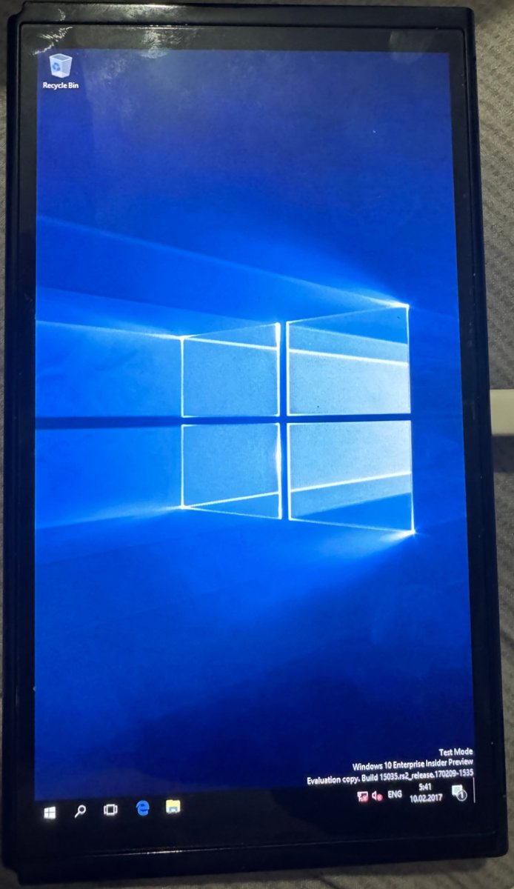
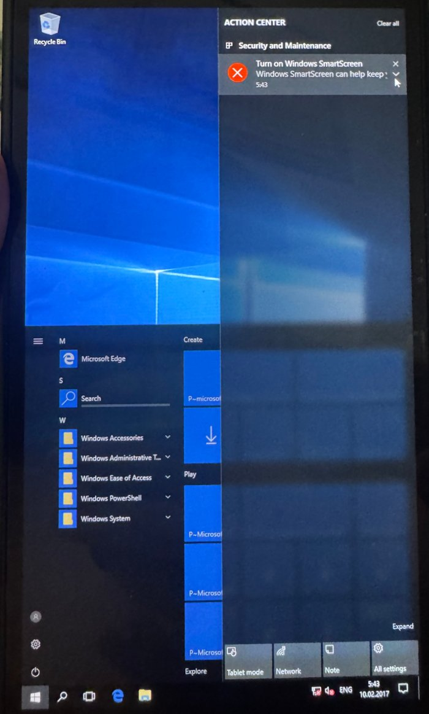
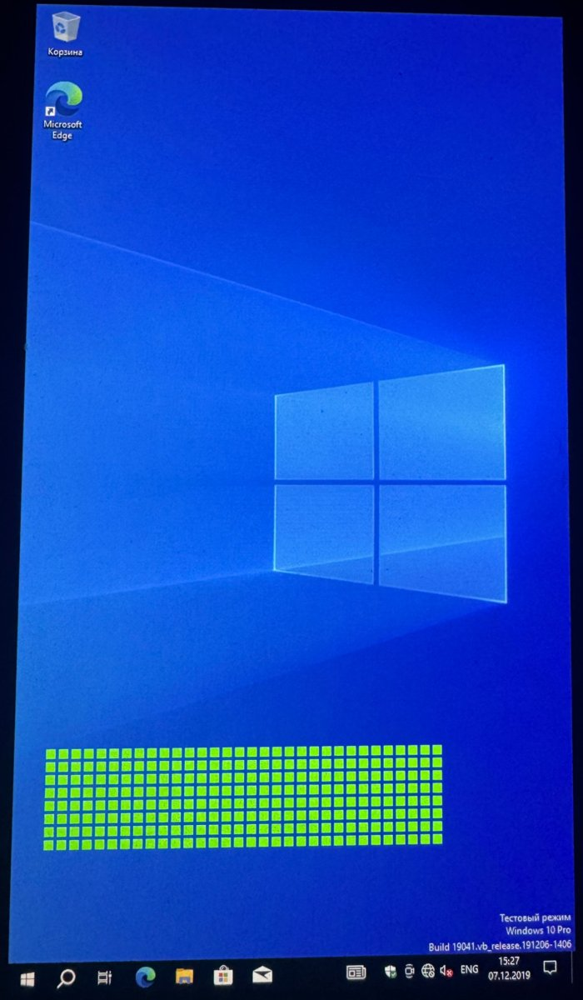

# Windows 10 Switch

Native Windows 10 on the Nintendo Switch: no emulation, no Linux underneath. Hekate starts our
own EL2 shim, the shim starts a patched [NintendoSwitchPkg](https://github.com/imbushuo/NintendoSwitchPkg)
UEFI, and UEFI boots a regular Windows Boot Manager from the SD card.

| Windows 10 ARM32 (build 15035) | ARM32 Start menu and Action Center | Windows 10 ARM64 (22H2) |
|:---:|:---:|:---:|
|  |  |  |

> **The first rule of this project is not to harm the console.** Everything here was tested on one
> Mariko unit (T210B01, HAC-001-01). Clock and voltage changes stay within the limits used by
> Horizon. Use at your own risk.

## Status

| | Windows 10 ARM32 | Windows 10 ARM64 |
|---|---|---|
| Build | 15035 (Enterprise Insider Preview) | 19041/19045 (22H2 Pro) |
| Boot to desktop | yes, autologon as user `Player` | yes, autologon as user `Player` |
| CPU cores | 1 | 4 (via PSCI trapping in the shim, being tested) |
| SD card | inbox `sdbus` | inbox `sdbus` through the shim's stage-2 trap |
| Touch screen | yes, multi-touch (`drivers/swhid`) | not yet (driver is ARM32-only so far) |
| Battery, charger, fan, overheat shutdown | yes (`drivers/swbatt`) | not yet |
| CPU / RAM clocks | 1785 MHz at 1120 mV / ~1600 MHz | same UEFI code |
| Display | GOP framebuffer (Basic Display), portrait | same |
| USB, Wi-Fi, Bluetooth, audio, GPU | no | no |

## How it works

```
Hekate (l4t=1) ──> BL31 (ATF, EL3) ──> shim, bl33 (EL2) ──> UEFI (EL1) ──> Windows Boot Manager ──> Windows (EL1)
```

### Shim (`shim/`)

Hekate's L4T loader starts `bl33.bin` at 0xAA000000 in EL2. The shim:

- waits a few seconds (`--delay-ms`): on Mariko the BPMP firmware is still training DRAM after
  Hekate, and early UEFI hung while that was in progress (3 s for ARM32, 10 s for ARM64, whose
  early UEFI memory sits above 4 GB);
- copies UEFI to 0x80110000 and drops to EL1, either AArch32 (`chain32`) or AArch64 (`chain`);
- **ARM64 only** stays resident as a minimal hypervisor in reserved memory:
  - **SMC/PSCI trapping** (`HCR_EL2.TSC`). ATF starts secondary cores at EL2, so `PSCI CPU_ON`
    is rewritten to enter `secondary_entry`, which drops the new core to EL1 and jumps to the
    Windows entry point;
  - the trap is switched on only when UEFI hands over to the OS. UEFI signals this by reading
    `ACTLR_EL1` (trapped through `HCR_EL2.TACR`), because ATF disables HVC;
  - **stage-2 translation** maps everything 1:1 except the SDMMC page 0x700B0000. Windows
    accesses to it are emulated with the same width and logged, and bit 28 ("64-bit system bus")
    of the SDMMC1 capabilities register is cleared, so `sdbus` uses 32-bit ADMA2 like ARM32 does;
  - **SError handling** (`HCR_EL2.AMO`): an asynchronous bus error is swallowed. On the first one,
    ESR, ELR and the latest SD register accesses are drawn as bit rows at the top of the screen.
    This is how the ARM64 hangs below were diagnosed without a UART.

### UEFI (`uefi/`, `patches/`)

`uefi/build.sh` builds NintendoSwitchPkg on `edk2-stable202102` in Docker and applies
`patches/*.patch` in alphabetical order. Patches named `*-a64only.patch` go into the 64-bit build
only, and `*-cleanonly.patch` only into `CLEAN=1` builds.

| Patch | What it does |
|---|---|
| `hekate`, `sd-power`, `zsdhost` | boot from Hekate's L4T entry; power up SDMMC1 the way Hekate does; SD host fixes; describe SDMMC1 (`PNP0D40`) in the DSDT |
| `zarm32` | 32-bit (ARM) build of the package |
| `zzfan` | fan on at boot |
| `zzztouch`, `zzzztouchacpi` | touch panel power-up, `SWTS0001` ACPI device for the HID driver |
| `zzzzzzzclean`, `*clean-cleanonly` | optional black (clean) boot screen |
| `*cpu1428` | CPU 1785.6 MHz at 1120 mV (MAX77812 over I2C5, PLLX reprogrammed while running from clk_m) |
| `*bpmp` | RAM ~1600 MHz: asks the BPMP firmware over IPC (`MRQ_CLK`, clock `emc`) |
| `*ram408` | older Hekate-style RAM boost (unused, must not be combined with BPMP) |
| `*diag` | small progress marks at the bottom of the screen |
| `*el1-a64only`, `*shim-a64only`, `*ebs-a64only` | AArch64 at EL1; reserve the shim's 1 MB; ExitBootServices signal to the shim |
| `*rtnull-a64only` | Null DebugLib/SerialPortLib for runtime drivers (they crashed after SetVirtualAddressMap) |
| `*nouart-a64only` | hide UART B (`NVDA0100`): it is unclocked and the inbox ARM64 driver hit an SError |
| `*cca-a64only` | `_CCA = 0` on SDMMC1: Tegra SDMMC DMA does not snoop CPU caches |
| `*bootopt-a64only` | register "Windows Boot Manager" with a full partition device path (needed by Windows Setup) |

### Windows images (`desktop/`)

Windows files are not part of this repository. The scripts build NTFS partition images from your own
Microsoft images inside a Linux container (`ntfs-3g`, `hivex`, `wimlib`):

- `build_w32.sh`: Windows 10 ARM32 from a 15035 archive. Adds the answer file, the `swagent`
  diagnostics service, the drivers, and a setup wrapper that keeps the setup logs.
- `build_w64.sh`: Windows 10 ARM64 from an ESD, same tricks.
- `make_bcd.sh`, `make_bcd64.sh`, `bcdlib.py`: BCD stores pointing at the MBR partitions.
- `skip_bcd_step.sh`: removes `Sysprep_Specialize_Bcd`, which needs persistent UEFI variables.
- `setup_arm64_card.py`, `put_bl33.sh`, `put_bcd.sh`, `finalize_menu.py`, `make_icon.py`: install
  onto the card and the Hekate menu.
- `pull_win.py`, `push_win.py`, `img_sums.py`, `sync_from_card.py`, `replace_extent.py`,
  `hive_recover.py`, `setup_mode.sh`, `finish_setup.sh`: offline maintenance. They copy a partition,
  write back only the changed MiB, patch a registry hive in place, and recover hives left dirty
  by a power-off.
- `w32.cmd`, `w64.cmd`: run by `swagent` on every boot from the CRASHDUMP partition. The Mac can
  edit them without root, and they write logs that can be read back from the Mac.

### Drivers (`drivers/`)

KMDF/WDM drivers built in Docker with an extracted Enterprise WDK (not included), test-signed:

- `swhid`: HID touch screen digitizer for the FTS4 panel on I2C3 (up to 5 fingers);
- `swbatt`: battery class miniport (MAX17050 fuel gauge, BQ24193 charger, TMP451 temperature),
  fan curve and overheat shutdown.

Both are ARM32 only for now; ARM64 builds are next.

## SD card layout (MBR)

| # | Start | Size | Contents |
|---|---|---|---|
| 1 | 2 MiB | | FAT32, type EF: Hekate, `wp/` (ARM32 loader), `wp64/` (ARM64 loader), ARM32 boot manager and BCD |
| 2 | 10815 MiB | 12 GiB | NTFS: Windows 10 ARM32 |
| 3 | 1416 MiB | 600 MB | FAT `CRASHDUMP`: ARM64 boot manager and BCD, `agent\` scripts and logs |
| 4 | 23104 MiB | 24 GiB | NTFS: Windows 10 ARM64 |

Hekate menu entries (`bootloader/ini/*.ini`):

```ini
[Windows 10 ARM32]
l4t=1
boot_prefixes=wp/
uart_port=2

[Windows 10 ARM64]
l4t=1
boot_prefixes=wp64/
uart_port=2
```

Each folder holds `bl31.bin` (from an L4T release) and our `bl33.bin`.

## Building

Requirements: macOS or Linux with `clang`, Docker, Python 3. For images: your own Windows 10 ARM32
15035 / ARM64 ESD. For drivers: an extracted Enterprise WDK.

```bash
# 32-bit UEFI + shim (ARM32)
./uefi/build_bl33.sh uefi/out/bl33-arm.bin

# 64-bit UEFI + shim (ARM64); repack with a longer start-up delay
ARCH=AARCH64 ./uefi/build_bl33.sh uefi/out/bl33-64.bin
python3 shim/build.py chain uefi/out/NintendoSwitch.fd --clean --delay-ms 10000 -o uefi/out/bl33-64.bin

# put a loader on the card (macOS, card exposed by Hekate's USB tools)
sudo ./desktop/put_bl33.sh disk4 <card size in bytes> uefi/out/bl33-64.bin wp64
```

`shim/test_shim.py` runs the shim in Unicorn to check its control flow without a console.

## Lessons learned

- **Early UEFI hang after mark 6** on Mariko: BPMP DRAM training races UEFI start. Fixed with a
  delay in the shim.
- **All EL2 traps hung**: `SP_EL2` was never set because `SPSel` was 0. Set `SPSel=1` before
  setting the handler stack.
- **ARM64 runtime services crashed** after `SetVirtualAddressMap`: runtime drivers still used the
  serial/debug libraries. Fixed with Null libraries.
- **INACCESSIBLE_BOOT_DEVICE** on ARM64: `sdbus`/`sdstor` must be boot-start (`Start=0`).
- **ARM64 froze at the spinner, whole peripheral bus dead.** The stage-2 SD access log showed
  64-bit ADMA2 reading stale descriptors. Windows ARM64 treats devices without `_CCA` as cache
  coherent and skips cache maintenance, but Tegra SDMMC is not coherent. Fixed with `_CCA = 0` and
  32-bit DMA.
- **"Windows could not update the computer's boot configuration"**: Windows Setup finds its system
  partition through `BootCurrent`. EDK2's automatic removable-media option has no partition
  node, so UEFI now registers a full-path option. After such a failure, set
  `HKLM\SYSTEM\Setup\Status\ChildCompletion\setup.exe = 3`.
- **BCD `truncatememory` is not honoured** by ARM64 Windows for DMA buffers.
- Moving the 64-bit UEFI's memory region below 4 GB breaks its early start.

## Roadmap

- ARM64: clean up diagnostics, confirm 4-core stability, ARM64 builds of `swhid` and `swbatt`.
- USB host (XUSB firmware load in UEFI + inbox XHCI), then networking.
- Wi-Fi, Bluetooth and audio. [winx](https://github.com/steck0714/winx) has GPL-2.0 ARM64
  drivers for these, to be reviewed and ported.
- ARM32 on 4 cores through the same PSCI trapping (needs an AArch32 trap path).
- Windows 11 ARM64 up to 23H2. 24H2 and later need ARMv8.1 atomics, which Cortex-A57 lacks.

## Credits

- [imbushuo/NintendoSwitchPkg](https://github.com/imbushuo/NintendoSwitchPkg) and
  [EDK2](https://github.com/tianocore/edk2): the UEFI this is built on.
- [CTCaer/hekate](https://github.com/CTCaer/hekate): bootloader, L4T loader, SDMMC and BPMP know-how.
- Switchroot / L4T: BL31 and the Mariko BPMP firmware flow.
- [steck0714/winx](https://github.com/steck0714/winx): a parallel effort with Windows 11 ARM64 drivers.

## License

Our code (shim, drivers, scripts, patches) is GPL-2.0, see `LICENSE`. The patches apply to
NintendoSwitchPkg and EDK2, which keep their own licenses. Microsoft files (Windows images, boot
managers, BCD), drivers built with the WDK, the test-signing private key and UEFI build outputs are
not distributed here.
